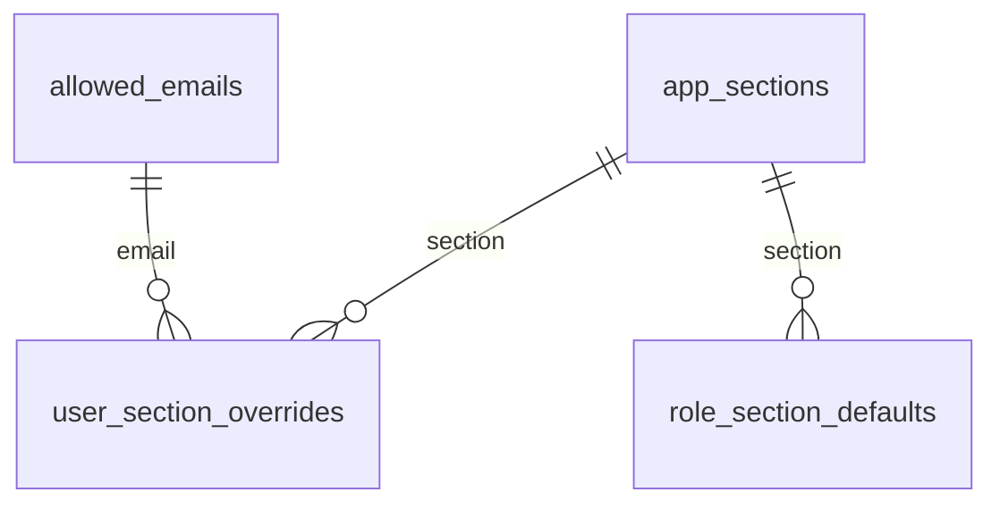
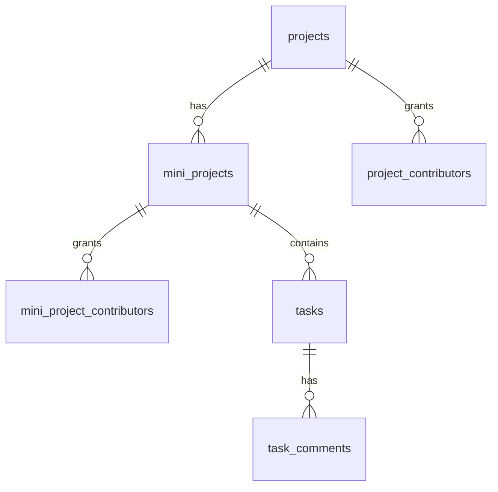
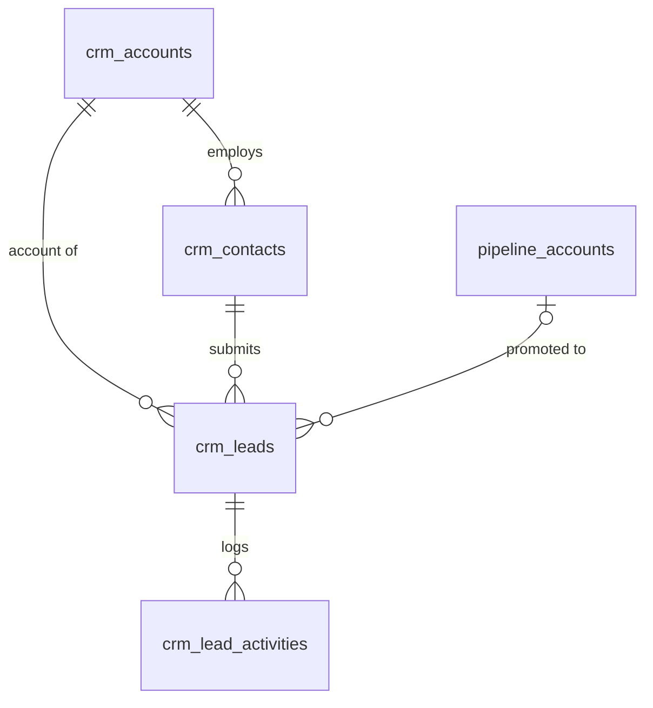
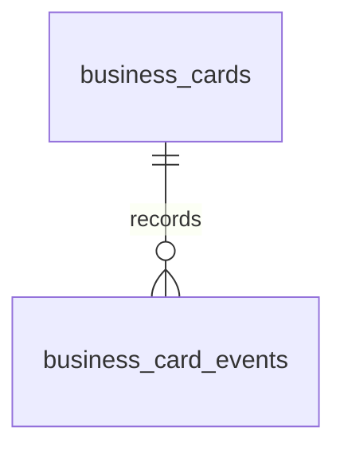

# Database ERD

Entity-relationship reference for the Bughaw Suite Postgres schema, derived from
`supabase/migrations/0001`–`0013`. For RLS policies, SQL functions and migration
notes see [database.md](database.md). This document is about **shape**: tables,
columns, keys, and how they relate.

> Source of truth is the migrations. If this file and a migration disagree, the
> migration wins; update this file.

## 1. Reading this diagram

- **Solid relationships** are real foreign keys (`references ...`).
- **Dotted relationships** are *soft links*: columns that hold an email (or a
  key) and are matched by `lower()` comparison in policies/functions, with **no
  FK constraint**. Mermaid has no dotted-line ERD syntax, so soft links are drawn
  as `..` lines labelled `(soft)`.
- `auth.users` (Supabase-managed) is shown only where the app references it.
- Tables with RLS enabled and **no policies** (`allowed_emails`,
  `crm_ingest_secrets`, `app_sections`, `role_section_defaults`,
  `user_section_overrides`) are reachable only via service role or
  security-definer functions.

## 2. Full ERD

```mermaid
erDiagram
    %% ---------- Identity & access ----------
    allowed_emails {
        text email PK
        text note
        app_role role "super_admin | member | contractor"
        timestamptz added_at
    }
    app_sections {
        text key PK
        text label
        text group_label
        int sort_order
    }
    role_section_defaults {
        app_role role PK
        text section PK, FK
        boolean allowed
    }
    user_section_overrides {
        text email PK, FK
        text section PK, FK
        boolean allowed
        timestamptz updated_at
        text updated_by_email
    }

    allowed_emails ||--o{ user_section_overrides : "email (cascade)"
    app_sections ||--o{ role_section_defaults : "section (cascade)"
    app_sections ||--o{ user_section_overrides : "section (cascade)"

    %% ---------- Tasks ----------
    projects {
        uuid id PK
        text name
        text description
        text created_by_email
        timestamptz created_at
        timestamptz updated_at
    }
    mini_projects {
        uuid id PK
        uuid project_id FK
        text name
        text description
        text created_by_email
        timestamptz created_at
        timestamptz updated_at
    }
    project_contributors {
        uuid project_id PK, FK
        text user_email PK
        text added_by_email
        timestamptz created_at
    }
    mini_project_contributors {
        uuid mini_project_id PK, FK
        text user_email PK
        text added_by_email
        timestamptz created_at
    }
    tasks {
        uuid id PK
        uuid mini_project_id FK
        text title
        text description
        text status "To Do | In Progress | Done"
        text priority "Low | Medium | High"
        date due_date
        text assignee_email
        double position "fractional ordering"
        text created_by_email
        timestamptz created_at
        timestamptz updated_at
    }
    task_comments {
        uuid id PK
        uuid task_id FK
        text body
        text author_email
        timestamptz created_at
    }

    projects ||--o{ mini_projects : "project_id (cascade)"
    projects ||--o{ project_contributors : "project_id (cascade)"
    mini_projects ||--o{ mini_project_contributors : "mini_project_id (cascade)"
    mini_projects ||--o{ tasks : "mini_project_id (cascade)"
    tasks ||--o{ task_comments : "task_id (cascade)"

    allowed_emails ||..o{ project_contributors : "user_email (soft)"
    allowed_emails ||..o{ mini_project_contributors : "user_email (soft)"
    allowed_emails ||..o{ tasks : "assignee_email (soft)"

    %% ---------- CRM ----------
    crm_accounts {
        uuid id PK
        text name
        text name_key UK "generated: lower(btrim(name))"
        text kind "hotel | company"
        text industry
        text hotel_star_rating "3-Star | 4-Star | 5-Star | Unrated | null"
        text hotel_room_count_band "<50 | 50-100 | 101-200 | 200+ | null"
        timestamptz created_at
        timestamptz updated_at
    }
    crm_contacts {
        uuid id PK
        uuid account_id FK "nullable"
        text full_name
        text email
        text email_key UK "generated: lower(btrim(email))"
        text job_title
        timestamptz created_at
        timestamptz updated_at
    }
    crm_leads {
        uuid id PK
        uuid contact_id FK "nullable"
        uuid account_id FK "nullable"
        uuid pipeline_account_id FK "nullable"
        text origin_form "contact | for_hotels | inquiry_api | manual | import"
        text lead_type "general | hotel_pilot | inquiry"
        text status "New | Acknowledged | Qualified | Pilot Scoping | Closed Won | Closed Lost"
        double position "fractional ordering"
        text source
        text_array product_interests
        text product_of_interest
        text estimated_volume
        text description
        text engagement_tier
        text ga_client_id
        jsonb attribution
        jsonb engagement
        jsonb geo
        jsonb raw "original payload"
        text owner_email FK "-> allowed_emails.email; reserved, unused"
        timestamptz submitted_at
        timestamptz created_at
        timestamptz updated_at
    }
    crm_lead_activities {
        uuid id PK
        uuid lead_id FK
        text kind "note | status_change | system"
        text body
        text from_status
        text to_status
        text author_email
        timestamptz created_at
    }
    crm_ingest_secrets {
        text name PK
        text secret "plaintext, service-role only"
        timestamptz created_at
    }

    crm_accounts ||--o{ crm_contacts : "account_id (set null)"
    crm_accounts ||--o{ crm_leads : "account_id (set null)"
    crm_contacts ||--o{ crm_leads : "contact_id (set null)"
    crm_leads ||--o{ crm_lead_activities : "lead_id (cascade)"
    pipeline_accounts |o--o{ crm_leads : "pipeline_account_id (set null)"

    %% ---------- Workspace (shared team data) ----------
    pipeline_accounts {
        uuid id PK
        text name
        text property
        text segment "A | B"
        text stage "Warm Contact | Meeting Secured | Sample Delivered | PO Signed | Repeat Order | Disqualified"
        text contact
        text notes
        text reason
        text referred_by
        boolean generated_referral
        timestamptz created_at
        timestamptz updated_at
    }
    app_state {
        text key PK
        jsonb value
        timestamptz updated_at
    }
    saved_calculations {
        uuid id PK
        text calculator_id
        text label
        jsonb inputs
        jsonb outputs
        uuid created_by "default auth.uid()"
        text created_by_email
        timestamptz created_at
    }

    app_sections ||..o{ app_state : "key to section via app_state_section() (soft)"

    %% ---------- Digital business cards ----------
    business_cards {
        uuid id PK
        text token UK "12 chars [A-Za-z0-9]"
        text status "draft | published | suspended"
        text owner_email "lower-cased"
        text full_name
        text job_title
        text bio "max 150"
        text photo_url "https only"
        text email
        text phone
        boolean show_phone
        boolean phone_on_viber
        text linkedin_url
        text facebook_url
        text instagram_url
        text website_url
        text company_blurb "max 400"
        text cta_label
        text cta_url
        text created_by_email
        timestamptz created_at
        timestamptz updated_at
    }
    business_card_events {
        bigint id PK "identity"
        uuid card_id FK
        text event "view | save_contact | click | wallet_apple | wallet_google"
        text target "email | phone | viber | linkedin | facebook | instagram | website | cta"
        text source "link | qr | nfc | email"
        text device "mobile | tablet | desktop | unknown"
        timestamptz occurred_at
    }

    business_cards ||--o{ business_card_events : "card_id (cascade)"
    allowed_emails ||..o{ business_cards : "owner_email (soft)"
```

## 3. Domain views

Smaller diagrams per area, for readability.

### 3.1 Identity & page access

Effective access = `super_admin` → all; else `user_section_overrides` ??
`role_section_defaults` ?? none (`has_section()`, migration 0010).

### 3.2 Tasks

### 3.3 CRM

### 3.4 Digital cards

## 4. Table inventory

| Table | Domain | Rows are | RLS access (summary) | Migration |
|---|---|---|---|---|
| `allowed_emails` | Identity | One per invited person; holds `role` | No policies (service role / definer fns) | 0001, 0002 |
| `app_sections` | Access | Catalog of gateable sections | No policies | 0010 |
| `role_section_defaults` | Access | Per-role section default | No policies | 0010 |
| `user_section_overrides` | Access | Per-person allow/deny | No policies | 0010 |
| `projects` | Tasks | Project | Contributor-scoped; create/delete super_admin | 0002 |
| `mini_projects` | Tasks | Board within a project | Contributor-scoped | 0002 |
| `project_contributors` | Tasks | Email grant on a project (cascades to boards) | Contributor-scoped | 0002 |
| `mini_project_contributors` | Tasks | Email grant on one board | Contributor-scoped | 0002 |
| `tasks` | Tasks | Kanban card | Board access; contractors edit own only | 0002 |
| `task_comments` | Tasks | Append-only comment | Board access; no update/delete | 0002 |
| `crm_accounts` | CRM | Company/hotel, deduped on `name_key` | `has_section('crm')` | 0003 |
| `crm_contacts` | CRM | Person, deduped on `email_key` | `has_section('crm')` | 0003 |
| `crm_leads` | CRM | One per submission (never deduped) | `has_section('crm')`; delete super_admin | 0003 |
| `crm_lead_activities` | CRM | Append-only activity log | `has_section('crm')` | 0003 |
| `crm_ingest_secrets` | CRM | Shared secret for ingest | No policies | 0003 |
| `pipeline_accounts` | Workspace | Mini-CRM pipeline account | Section-gated shared team data | 0001 |
| `app_state` | Workspace | Shared JSONB docs by key | Section-gated via `app_state_section()` | 0001 |
| `saved_calculations` | Workspace | Saved calculator run | Section-gated shared team data | 0001 |
| `business_cards` | Cards | Digital card | super_admin only; public read via RPC | 0009 |
| `business_card_events` | Cards | Append-only analytics event | super_admin select; insert via RPC only | 0009 |

## 5. Data dictionary (tables, fields, mapping)

Conventions: **Null** = `NN` (not null) or `Y` (nullable). Every `uuid` PK
defaults to `gen_random_uuid()`. `*_by_email` / `author_email` defaults come from
the caller's JWT (`auth.jwt() ->> 'email'`). Timestamps are `timestamptz`
defaulting to `now()`.

### 5.1 Identity & page access

#### `allowed_emails` (0001, 0002)
| Field | Type | Null | Default | Constraint / mapping |
|---|---|---|---|---|
| `email` | text | NN | | **PK**. Invite list; matched `lower()` against JWT email |
| `note` | text | Y | `''` | Free-text label |
| `role` | `app_role` | NN | `'member'` | enum `super_admin` / `member` / `contractor`; read via `current_user_role()` |
| `added_at` | timestamptz | NN | `now()` | |

Trigger `enforce_signup_allowlist` on `auth.users` rejects signups not in this table.

#### `app_sections` (0010)
| Field | Type | Null | Default | Constraint / mapping |
|---|---|---|---|---|
| `key` | text | NN | | **PK**. Must match `SECTIONS` in `src/lib/access.ts` |
| `label` | text | NN | | Display name |
| `group_label` | text | NN | | `Sections` or `Tools` |
| `sort_order` | int | NN | `0` | |

Seeded keys: `crm`, `tasks`, `calculators`, `saved`, `tool:pipeline`,
`tool:cost-calculator`, `tool:unit-economics`, `tool:pnl`, `tool:funding`, and more
(see 0010).

#### `role_section_defaults` (0010)
| Field | Type | Null | Default | Constraint / mapping |
|---|---|---|---|---|
| `role` | `app_role` | NN | | **PK (1/2)** |
| `section` | text | NN | | **PK (2/2)**, **FK** → `app_sections.key` (cascade) |
| `allowed` | boolean | NN | | |

#### `user_section_overrides` (0010)
| Field | Type | Null | Default | Constraint / mapping |
|---|---|---|---|---|
| `email` | text | NN | | **PK (1/2)**, **FK** → `allowed_emails.email` (cascade delete + update) |
| `section` | text | NN | | **PK (2/2)**, **FK** → `app_sections.key` (cascade) |
| `allowed` | boolean | NN | | |
| `updated_at` | timestamptz | NN | `now()` | |
| `updated_by_email` | text | Y | JWT email | |

### 5.2 Tasks

#### `projects` (0002)
| Field | Type | Null | Default | Constraint / mapping |
|---|---|---|---|---|
| `id` | uuid | NN | gen | **PK** |
| `name` | text | NN | | |
| `description` | text | NN | `''` | |
| `created_by_email` | text | Y | JWT email | Soft link → `allowed_emails.email` |
| `created_at`, `updated_at` | timestamptz | NN | `now()` | |

#### `mini_projects` (0002)
| Field | Type | Null | Default | Constraint / mapping |
|---|---|---|---|---|
| `id` | uuid | NN | gen | **PK** |
| `project_id` | uuid | NN | | **FK** → `projects.id` (cascade); indexed |
| `name` | text | NN | | |
| `description` | text | NN | `''` | |
| `created_by_email` | text | Y | JWT email | Soft link |
| `created_at`, `updated_at` | timestamptz | NN | `now()` | |

#### `project_contributors` (0002)
| Field | Type | Null | Default | Constraint / mapping |
|---|---|---|---|---|
| `project_id` | uuid | NN | | **PK (1/2)**, **FK** → `projects.id` (cascade) |
| `user_email` | text | NN | | **PK (2/2)**. Soft link → `allowed_emails.email`; indexed. Grants access to all mini-projects |
| `added_by_email` | text | Y | JWT email | |
| `created_at` | timestamptz | NN | `now()` | |

#### `mini_project_contributors` (0002)
| Field | Type | Null | Default | Constraint / mapping |
|---|---|---|---|---|
| `mini_project_id` | uuid | NN | | **PK (1/2)**, **FK** → `mini_projects.id` (cascade) |
| `user_email` | text | NN | | **PK (2/2)**. Soft link; indexed. Grants access to that board only |
| `added_by_email` | text | Y | JWT email | |
| `created_at` | timestamptz | NN | `now()` | |

#### `tasks` (0002)
| Field | Type | Null | Default | Constraint / mapping |
|---|---|---|---|---|
| `id` | uuid | NN | gen | **PK** |
| `mini_project_id` | uuid | NN | | **FK** → `mini_projects.id` (cascade); indexed (also with `status`) |
| `title` | text | NN | | |
| `description` | text | NN | `''` | |
| `status` | text | NN | `'To Do'` | CHECK `To Do` / `In Progress` / `Done` |
| `priority` | text | NN | `'Medium'` | CHECK `Low` / `Medium` / `High` |
| `due_date` | date | Y | | |
| `assignee_email` | text | Y | | Soft link → `allowed_emails.email` |
| `position` | double precision | NN | `0` | Fractional ordering (`computeNewPosition`, `src/lib/tasks.ts`) |
| `created_by_email` | text | NN | JWT email | Used by RLS: contractors edit only their own |
| `created_at`, `updated_at` | timestamptz | NN | `now()` | |

#### `task_comments` (0002)
| Field | Type | Null | Default | Constraint / mapping |
|---|---|---|---|---|
| `id` | uuid | NN | gen | **PK** |
| `task_id` | uuid | NN | | **FK** → `tasks.id` (cascade); indexed |
| `body` | text | NN | | |
| `author_email` | text | NN | JWT email | |
| `created_at` | timestamptz | NN | `now()` | Append-only (no update/delete policy) |

### 5.3 CRM

#### `crm_accounts` (0003)
| Field | Type | Null | Default | Constraint / mapping |
|---|---|---|---|---|
| `id` | uuid | NN | gen | **PK** |
| `name` | text | NN | | |
| `name_key` | text | NN | generated `lower(btrim(name))` | **UNIQUE**; upsert conflict target |
| `kind` | text | NN | `'company'` | CHECK `hotel` / `company` |
| `industry` | text | Y | | NULL = none; CHECK not blank (0013) |
| `hotel_star_rating` | text | Y | | NULL = none; CHECK `3-Star`, `4-Star`, `5-Star`, `Unrated` |
| `hotel_room_count_band` | text | Y | | NULL = none; CHECK `<50`, `50–100`, `101–200`, `200+` (en dash) |
| `created_at`, `updated_at` | timestamptz | NN | `now()` | |

#### `crm_contacts` (0003)
| Field | Type | Null | Default | Constraint / mapping |
|---|---|---|---|---|
| `id` | uuid | NN | gen | **PK** |
| `account_id` | uuid | Y | | **FK** → `crm_accounts.id` (set null); indexed |
| `full_name` | text | Y | | NULL = none; CHECK not blank (0013) |
| `email` | text | NN | | |
| `email_key` | text | NN | generated `lower(btrim(email))` | **UNIQUE**; upsert conflict target |
| `job_title` | text | Y | | NULL = none; CHECK not blank (0013) |
| `created_at`, `updated_at` | timestamptz | NN | `now()` | |

#### `crm_leads` (0003)
| Field | Type | Null | Default | Constraint / mapping |
|---|---|---|---|---|
| `id` | uuid | NN | gen | **PK** |
| `contact_id` | uuid | Y | | **FK** → `crm_contacts.id` (set null); indexed |
| `account_id` | uuid | Y | | **FK** → `crm_accounts.id` (set null); indexed |
| `pipeline_account_id` | uuid | Y | | **FK** → `pipeline_accounts.id` (set null); set by "promote to pipeline" |
| `origin_form` | text | NN | | CHECK `contact` / `for_hotels` / `inquiry_api` / `manual` / `import` |
| `lead_type` | text | NN | `'general'` | CHECK `general` / `hotel_pilot` / `inquiry` |
| `status` | text | NN | `'New'` | CHECK `New` / `Acknowledged` / `Qualified` / `Pilot Scoping` / `Closed Won` / `Closed Lost`; indexed with `position` |
| `position` | double precision | NN | `0` | Fractional funnel ordering |
| `source` | text | Y | | NULL = none; CHECK not blank. Picklist in app: Referral, LinkedIn, Search, Event, Other |
| `product_interests` | text[] | NN | `'{}'` | Product ids P1–P5 |
| `product_of_interest` | text | Y | | NULL = none; CHECK not blank |
| `estimated_volume` | text | Y | | NULL = none; CHECK not blank |
| `description` | text | Y | | NULL = none; CHECK not blank |
| `engagement_tier` | text | Y | | NULL = none; `tier_1`..`tier_4`; CHECK not blank |
| `ga_client_id` | text | Y | | |
| `attribution`, `engagement`, `geo` | jsonb | Y | | Marketing-site metadata |
| `raw` | jsonb | Y | | Full original payload |
| `owner_email` | text | Y | | **FK** → `allowed_emails.email` (on update cascade, on delete set null); reserved, unused |
| `submitted_at` | timestamptz | NN | `now()` | Indexed desc |
| `created_at`, `updated_at` | timestamptz | NN | `now()` | |

#### `crm_lead_activities` (0003)
| Field | Type | Null | Default | Constraint / mapping |
|---|---|---|---|---|
| `id` | uuid | NN | gen | **PK** |
| `lead_id` | uuid | NN | | **FK** → `crm_leads.id` (cascade); indexed with `created_at` |
| `kind` | text | NN | `'note'` | CHECK `note` / `status_change` / `system` |
| `body` | text | NN | `''` | |
| `from_status`, `to_status` | text | Y | | Populated for `status_change` |
| `author_email` | text | NN | JWT email or `'system'` | |
| `created_at` | timestamptz | NN | `now()` | Append-only |

#### `crm_ingest_secrets` (0003)
| Field | Type | Null | Default | Constraint / mapping |
|---|---|---|---|---|
| `name` | text | NN | | **PK** |
| `secret` | text | NN | | Plaintext shared secret; compared in constant time by `ingest_form_submission()` |
| `created_at` | timestamptz | NN | `now()` | |

### 5.4 Workspace (shared team data)

#### `pipeline_accounts` (0001)
| Field | Type | Null | Default | Constraint / mapping |
|---|---|---|---|---|
| `id` | uuid | NN | gen | **PK** |
| `name` | text | NN | | |
| `property` | text | NN | `''` | |
| `segment` | text | NN | `'A'` | CHECK `A` / `B` |
| `stage` | text | NN | `'Warm Contact'` | CHECK `Warm Contact` / `Meeting Secured` / `Sample Delivered` / `PO Signed` / `Repeat Order` / `Disqualified` |
| `contact`, `notes`, `reason`, `referred_by` | text | NN | `''` | |
| `generated_referral` | boolean | NN | `false` | |
| `created_at`, `updated_at` | timestamptz | NN | `now()` | |

#### `app_state` (0001)
| Field | Type | Null | Default | Constraint / mapping |
|---|---|---|---|---|
| `key` | text | NN | | **PK**. Section via `app_state_section()`: `cost-calc` → `tool:cost-calculator`; `pipeline-*` → `tool:pipeline`; other → super_admin only |
| `value` | jsonb | NN | `'{}'` | Shared doc, last-write-wins |
| `updated_at` | timestamptz | NN | `now()` | |

#### `saved_calculations` (0001)
| Field | Type | Null | Default | Constraint / mapping |
|---|---|---|---|---|
| `id` | uuid | NN | gen | **PK** |
| `calculator_id` | text | NN | | Matches a config id in `src/lib/calculators/registry.ts` (no FK) |
| `label` | text | NN | `''` | |
| `inputs`, `outputs` | jsonb | NN | | |
| `created_by` | uuid | Y | `auth.uid()` | `auth.users.id`, no FK |
| `created_by_email` | text | Y | JWT email | |
| `created_at` | timestamptz | NN | `now()` | |

### 5.5 Digital cards

#### `business_cards` (0009)
| Field | Type | Null | Default | Constraint / mapping |
|---|---|---|---|---|
| `id` | uuid | NN | gen | **PK** |
| `token` | text | NN | `generate_card_token()` | **UNIQUE**; CHECK `^[A-Za-z0-9]{12}$`; the public URL `/c/<token>` |
| `status` | text | NN | `'draft'` | CHECK `draft` / `published` / `suspended` |
| `owner_email` | text | NN | `''` | CHECK lower-cased; soft link → `allowed_emails.email` |
| `full_name` | text | NN | | CHECK 1–120 chars |
| `job_title` | text | NN | `''` | ≤120 |
| `bio` | text | NN | `''` | ≤150 |
| `photo_url` | text | NN | `''` | `''` or `https://…`, ≤500 |
| `email` | text | NN | `''` | ≤254 |
| `phone` | text | NN | `''` | regex `^[0-9+() -]{0,30}$` |
| `show_phone`, `phone_on_viber` | boolean | NN | `false` | |
| `linkedin_url`, `facebook_url`, `instagram_url`, `website_url` | text | NN | `''` | `''` or `https://…`, ≤500 |
| `company_blurb` | text | NN | `''` | ≤400 |
| `cta_label` | text | NN | `''` | ≤40 |
| `cta_url` | text | NN | `''` | `''` or `https://…`, ≤500 |
| `created_by_email` | text | NN | lower-cased JWT email | Immutable (trigger `touch_business_card`) |
| `created_at` | timestamptz | NN | `now()` | Immutable (trigger) |
| `updated_at` | timestamptz | NN | `now()` | Set by trigger on update |

#### `business_card_events` (0009)
| Field | Type | Null | Default | Constraint / mapping |
|---|---|---|---|---|
| `id` | bigint | NN | identity | **PK** |
| `card_id` | uuid | NN | | **FK** → `business_cards.id` (cascade); indexed with `occurred_at desc` |
| `event` | text | NN | | CHECK `view` / `save_contact` / `click` / `wallet_apple` / `wallet_google` |
| `target` | text | Y | | CHECK null or `email` / `phone` / `viber` / `linkedin` / `facebook` / `instagram` / `website` / `cta` |
| `source` | text | NN | `'link'` | CHECK `link` / `qr` / `nfc` / `email` |
| `device` | text | NN | `'unknown'` | CHECK `mobile` / `tablet` / `desktop` / `unknown` |
| `occurred_at` | timestamptz | NN | `now()` | Inserted only via `record_card_event()` |

### 5.6 Form-to-CRM field mapping

Implemented twice and kept in sync by hand: in SQL by
`ingest_form_submission()` (0005) and in TypeScript by `normalizeSubmission()`
(`src/lib/crm.ts`), the latter used for manual entry and CSV import.
Both write `null`, never `''`, for any blank optional value (0013).
Provenance of each website field is documented in [FORMS_AUDIT.md](../FORMS_AUDIT.md).

| Target column | `for_hotels` form | `inquiry` / `inquiry_api` form | `contact` form |
|---|---|---|---|
| `crm_accounts.name` | `hotelName` | `name` (company name) | `company` |
| `crm_accounts.kind` | `hotel` | `company` | `company` |
| `crm_accounts.industry` | `Hospitality` | `null` | `null` |
| `crm_accounts.hotel_star_rating` | `starRating` (raw, blank → `null`) | `null` | `null` |
| `crm_accounts.hotel_room_count_band` | `roomCount` (raw, blank → `null`) | `null` | `null` |
| `crm_contacts.full_name` | `fullName` | `name` | `name` |
| `crm_contacts.email` | `email` | `email` | `email` |
| `crm_contacts.job_title` | `null` | `null` | `role` |
| `crm_leads.origin_form` | `for_hotels` | `inquiry_api` | `contact` |
| `crm_leads.lead_type` | `hotel_pilot` | `inquiry` | `general` |
| `crm_leads.source` | `source` (≤100) | `source` | `source` |
| `crm_leads.product_interests` | `interests[]` | `{}` | `{}` |
| `crm_leads.product_of_interest` | `product` (RPC) / `null` (TS) | `product` | `null` |
| `crm_leads.estimated_volume` | `quantity` (RPC) / `null` (TS) | `quantity` | `null` |
| `crm_leads.description` | `message` | `additionalInfo` | `message` |
| `crm_leads.engagement_tier` | `_engagement.tier` | `_engagement.tier` | `_engagement.tier` |
| `crm_leads.ga_client_id` | `_analytics.gaClientId` | same | same |
| `crm_leads.attribution` / `engagement` / `geo` | `_attribution` / `_engagement` / `_geo` | same | same |
| `crm_leads.raw` | whole payload | whole payload | whole payload |
| `crm_leads.status` / `position` | `New` / epoch seconds | same | same |

Upsert and dedupe rules:
- **Account:** upsert on `name_key`. An existing star rating / room band is
  only overwritten by a non-null incoming value; industry is only filled when null.
- **Contact:** upsert on `email_key`; `account_id` is updated with `coalesce`, and
  non-null names/titles win.
- **Lead:** always a new row per submission, never deduped.
- **Activity:** each ingest adds a `system` row, `Submitted via <form>`, `to_status = 'New'`.
- **Honeypot:** a non-empty `website_field_hp` returns `{status: 'dropped'}` and stores nothing.
- **Auth:** `p_secret` must match a row in `crm_ingest_secrets` (constant-time compare).
  `ingest_form_submission()` is the only function granted to `anon`.

### 5.7 Soft-link (email) mapping

| Column | Meaning | Resolved against |
|---|---|---|
| `projects.created_by_email`, `mini_projects.created_by_email` | Creator | `allowed_emails.email` (`lower()`) |
| `project_contributors.user_email` | Project-wide access grant | `allowed_emails.email` |
| `mini_project_contributors.user_email` | Board-scoped access grant | `allowed_emails.email` |
| `tasks.assignee_email`, `tasks.created_by_email` | Assignee / creator (RLS for contractors) | `allowed_emails.email` |
| `task_comments.author_email`, `crm_lead_activities.author_email` | Author | `allowed_emails.email` |
| `crm_leads.owner_email` | Reserved | **real FK** → `allowed_emails.email` (0013) |
| `business_cards.owner_email`, `created_by_email` | Card owner / creator | `allowed_emails.email` |
| `saved_calculations.created_by_email` | Saver | `allowed_emails.email` |
| `saved_calculations.created_by` | Saver id | `auth.users.id` |
| `user_section_overrides.email` | Per-person override | **real FK** → `allowed_emails.email` |

## 6. Observations for review

Facts surfaced while mapping the schema. They are neutral observations, not
decisions, intended as input for assessing changes.

1. **Email is the identity key, with no FK.** `project_contributors.user_email`,
   `mini_project_contributors.user_email`, `tasks.assignee_email`, every
   `*_by_email` / `author_email`, and `business_cards.owner_email` are free text. Only
   `user_section_overrides.email` and `crm_leads.owner_email` (0013) reference
   `allowed_emails(email)` (with `on update cascade`). Typos and
   renamed emails silently orphan data. Known gap in AGENTS.md §7.
2. **`allowed_emails` is not linked to `auth.users`.** The link is purely by
   lower-cased email via the JWT. `saved_calculations.created_by` is the only
   column storing an `auth.users` id, and it has no FK.
3. **Case handling is inconsistent.** CRM uses generated `*_key` columns,
   `business_cards.owner_email` has a lower-case CHECK, but
   `allowed_emails.email` and the contributor tables rely on `lower()` at
   comparison time, not a constraint.
4. **CRM picklists are CHECK constraints on text.** `hotel_star_rating` and
   `hotel_room_count_band` accept only exact strings (the room band uses an en
   dash `–`). Ingest passes the website's values through unchanged, so a
   non-matching value (e.g. `50-100` with an ASCII hyphen) raises a check
   violation and the entire lead insert fails. This is the cause of the
   `crm_accounts_hotel_room_count_band_check` ingest error.
5. **Lead references are all `on delete set null`.** Deleting a contact/account
   leaves orphaned leads; `admin_delete_lead()` (0012) handles cleanup in the
   other direction.
6. **`crm_leads` denormalizes the account link.** It stores `account_id` and
   `contact_id`, while `crm_contacts` also has `account_id`, so a lead's account
   can differ from its contact's account.
7. **`crm_leads.owner_email` is reserved but unused** (it is now a validated FK).
8. **`app_state` ↔ `app_sections` is a soft mapping** inside the
   `app_state_section()` function, not a table relationship. Unmapped keys are
   super_admin-only.
9. **Enums vs. text.** Only `app_role` is a real Postgres enum. All other
   vocabularies (task status/priority, lead status, pipeline stage, card status,
   etc.) are `text` + CHECK, so changing them needs a migration that rewrites the
   constraint.
10. **`business_card_events.id` is `bigint` identity**; every other table uses
    `uuid`.
11. **Two overlapping pipeline concepts:** `pipeline_accounts` (workspace mini-CRM
    with its own stage vocabulary) and `crm_leads.status` (funnel). They are
    joined only by the optional `crm_leads.pipeline_account_id`.
